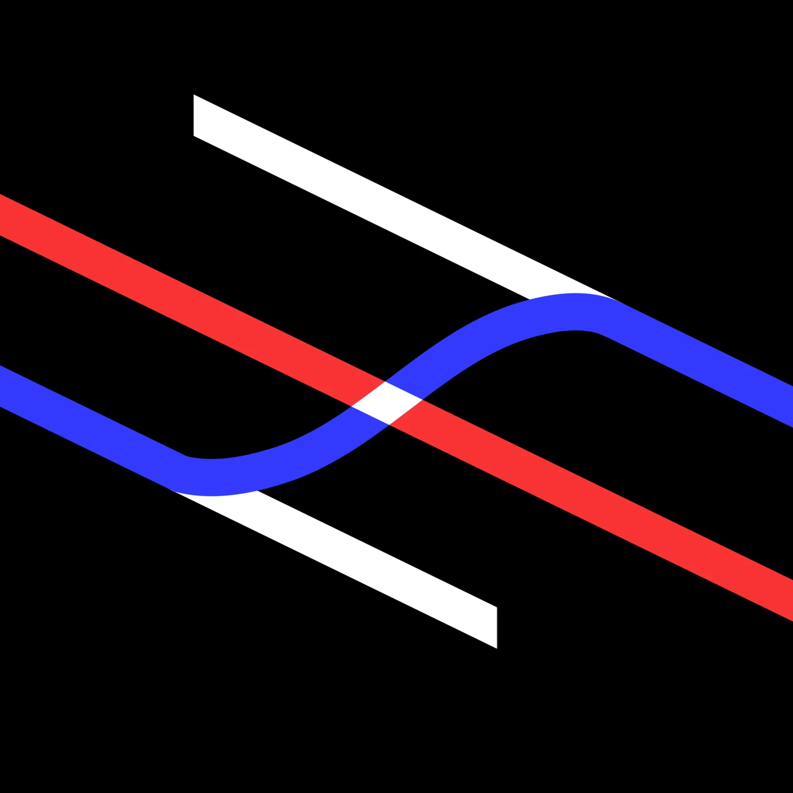

# 認識

<button class="tab-btn active" onclick="window.switchTabPanel('p-1', this, 'Group')">交會</button>
<button class="tab-btn" onclick="window.switchTabPanel('p-2', this, 'Group')">Met</button>
<button class="tab-btn" onclick="window.switchTabPanel('p-3', this, 'Group')">逢う時</button>

「我和你的認識，適逢與你的告別。」

“We met — just in time to say goodbye.”

:::lang[ja|no-format]
「最初の言葉は、『さよなら』だった。」
:::

