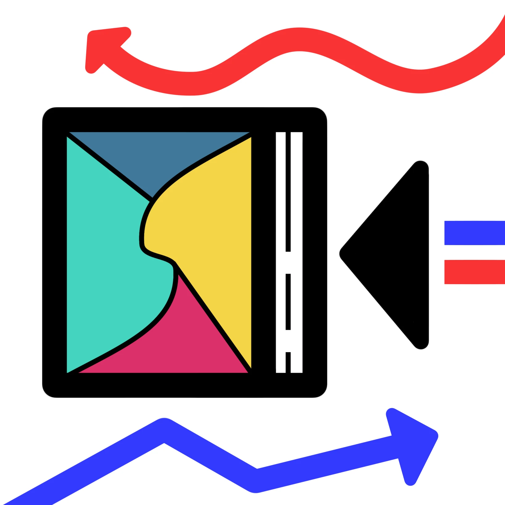

# 書

<button class="tab-btn active" onclick="window.switchTabPanel('p-1', this, 'Group')">經過</button>
<button class="tab-btn" onclick="window.switchTabPanel('p-2', this, 'Group')">while</button>
<button class="tab-btn" onclick="window.switchTabPanel('p-3', this, 'Group')">しばらく</button>

「書一直都在，興許妳會到達那個決定閱讀她的時間點。」

“The book is still there. Perhaps you will reach the moment when you decide to read it.”

:::lang[ja]
「本はずっとそこに。いつか、あなたがその本を読もうと決める時が来るかも。」
:::

