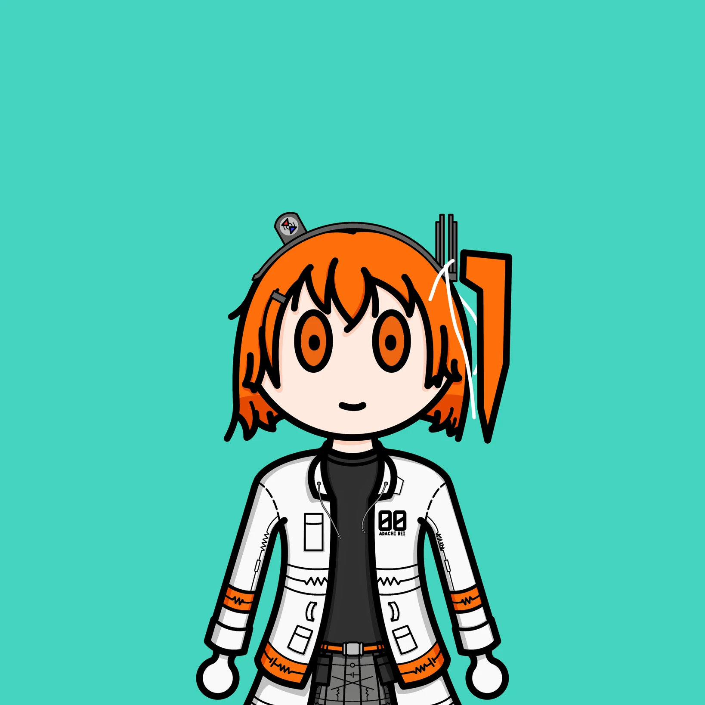
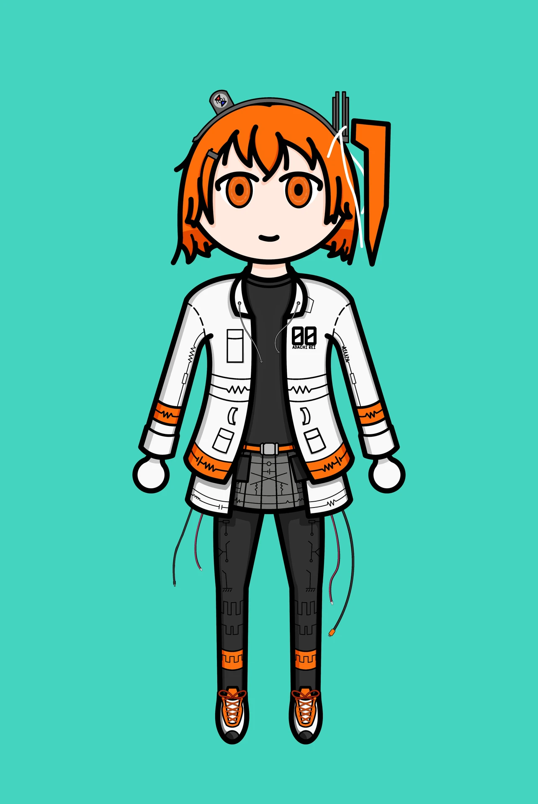

# 『足立レイ』
<figure class="float-right">
  
  <figcaption>基礎方塊</figcaption>
</figure>

用歌聲來訴說心中之情、手中之感的機器人。
> #只是想畫畫

:::highlight[UPDATED]

## 服裝

  <figure>
  <figcaption>公式服</figcaption></figure>

:::