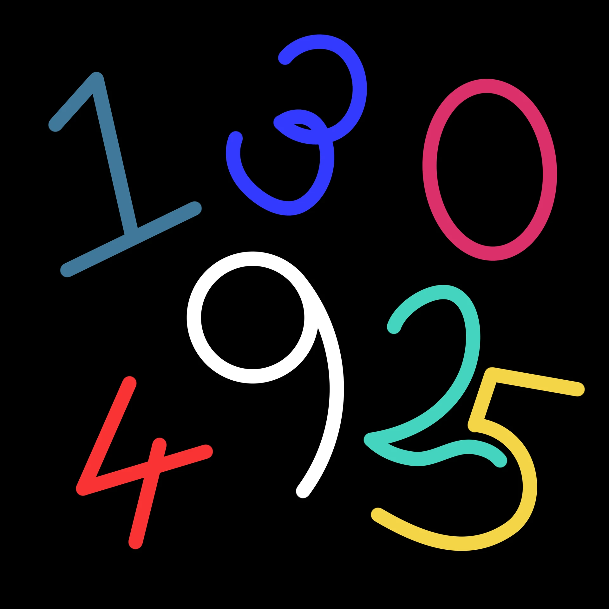

# 「數」

女孩有一個計劃，要在本子上紀錄數量，直到100。  
 
當日，  
女孩在公園裡交到了  
幾個朋友，她寫進了本子裡。  
 
又一天  
女孩在學校裡教到了  
更多的朋友，她寫進了本子裡。  
 
就這樣，朋友的數量一直在增加。  
   
但是卻沒有達成目標，  
因為  
少女有一個計劃，要在本子上紀錄數值，直到100。  
 
當周，  
女孩在練習中考到了  
一些分數，她寫進了本子裡。  
 
又一週，  
女孩在考試中考到了  
更多的分數，她寫進了本子裡。  
 
就這樣，分數的數值一直在增加。  
   
但是卻沒有達成目標，  
因為  
女子有一個計劃，要在本子上紀錄數字，直到100。  
 
當月，  
女子在工作中拿到了  
一些薪水，她寫進了本子裡。  
 
又一月，  
女子在加班中拿到了  
更多的薪水，她寫進了本子裡。  
 
就這樣，薪水的數字一直在增加。  
   
但是卻沒有達成目標，  
因為  
 
她這次也沒有繼續寫下去。