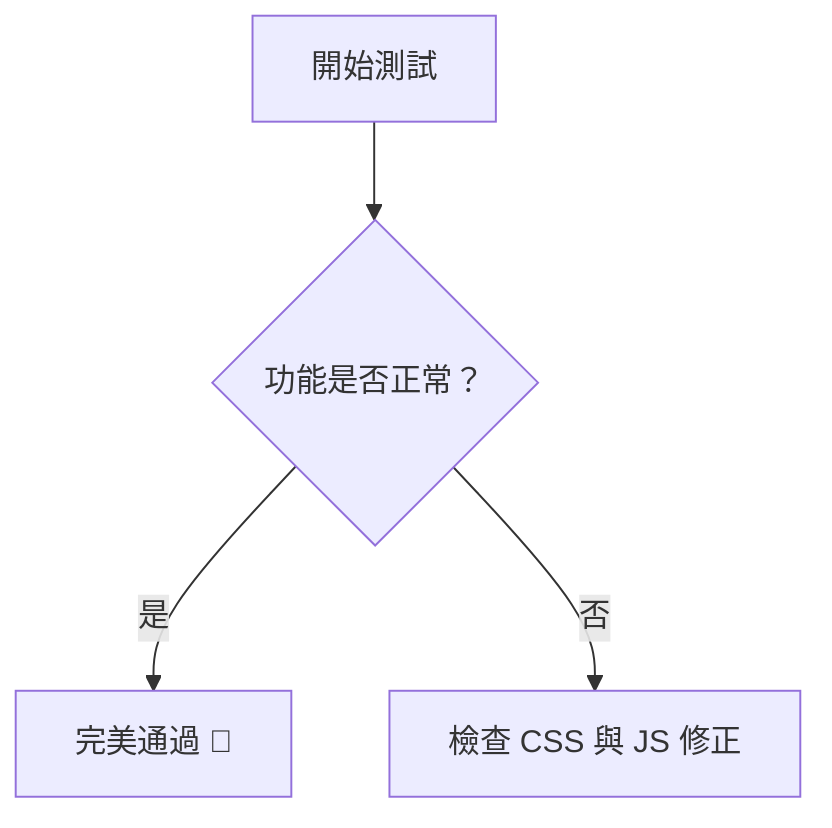

# 萬能測試 Markdown

這是一份用來測試所有自訂擴充功能、Markdown 排版與互動特效的綜合測試文件。

---

## 1. 基礎文字與多語系排版 (Typography & Language)
這是一般段落文字，包含**粗體**、*斜體*、~~刪除線~~，以及行內程式碼 `console.log('Hello World');`。  
這裡有一個內部錨點測試連結：[跳轉到下方結語](#文字系統小結)。

> 這是一段引言區塊 (Blockquote)。用來測試區塊引號的樣式與邊框是否正常顯示。

### 1.1 語言與注音標示 (Ruby & Lang Block)
進階注音與拼音測試：
* 預設日文：^^魔法(まほう)^^
* 指定語言：^^Apple(/ˈæp.əl/)[en]^^

**A. 標準多行日文排版測試（套用日文字體與日文專屬寬行距）：**

:::lang[ja]
**春はあけぼの。**
やうやう白くなりゆく山際、少し明かりて、紫だちたる雲の細くたなびきたる。
1. 第一段落支援清單
2. 內部也支援 ^^漢字(かんじ)^^
:::

**B. 不改行距與排版模式（`|no-format`，僅切換字體，行距與對齊完全繼承外部）：**

:::lang[ja|no-format]
「言葉」——這段日文使用了 `:::lang[ja|no-format]`，只會套用日文字體，行距與字距完全保持預設，不會撐開額外高度。
:::

<div id="lang-en" class="no-format">

This English paragraph uses `<div id="lang-en" class="no-format">`, applying the English font family while preserving the default line-height and letter-spacing.

</div>

---

### 1.2 多重分頁切換面板 (Tabbed Panels & Height Sync)

**A. 視窗高度自動鎖定測試（Group 1：搭配 `:::lang[...|no-format]` 與 `.md-divider`）**  
切換下方三個分頁時，系統會自動測量最長分頁（第一頁）的高度並鎖定，因此下方的分割線與版面絕對不會上下跳動，且點擊上方導覽列的「返回跳轉前」也會連同當下選中的分頁一起復原：

<div class="tab-buttons">
<button class="tab-btn active" onclick="window.switchTabPanel('p-1', this, 'Group')">中文</button>
<button class="tab-btn" onclick="window.switchTabPanel('p-2', this, 'Group')">EN</button>
<button class="tab-btn" onclick="window.switchTabPanel('p-3', this, 'Group')">JP</button>
</div>
<div id="p-1" class="tab-panel" data-group="Group" style="display: block;">

:::lang[zh|no-format]
這裡是第一頁（中文分頁），我們故意多寫幾行文字來撐高這個區塊。
* 測試項目一：**粗體文字**與 `行內程式碼`
* 測試項目二：包含防雷貼紙 ||分頁裡面的防雷貼紙也正常運作！||
* 測試項目三：包含內部跳轉測試 [跳轉到程式碼區塊](#程式碼區塊)（跳轉後可點左上角返回鍵測試分頁記憶復原）
:::

</div>
<div id="p-2" class="tab-panel" data-group="Group" style="display: none;">

:::lang[en|no-format]
"Words" — Even though this tab only has a single line of text, the container height remains locked to match the tallest tab in `Group`!
:::

</div>
<div id="p-3" class="tab-panel" data-group="Group" style="display: none;">

:::lang[ja|no-format]
「^^言葉(ことば)^^」——切換到這頁較短的日文時，下方的 `.md-divider` 依然穩如泰山，不會發生版面收縮跳動。
:::

</div>
<div class="md-tab-end divider"></div>

**B. 同文章第二組獨立分頁（Group 2：測試多組互不干擾 & `data-sync="false"` 自由高度）**

<div class="tab-buttons">
<button class="tab-btn active" onclick="window.switchTabPanel('pov-a', this, 'POV-Group')">視角 A（自由高度）</button>
<button class="tab-btn" onclick="window.switchTabPanel('pov-b', this, 'POV-Group')">視角 B（自由高度）</button>
</div>

<div id="pov-a" class="tab-panel" data-group="POV-Group" data-sync="false" style="display: block;">

這是第二組分頁的 **視角 A**。因為加上了 `data-sync="false"`，這組分頁會隨內容自然伸縮，且切換時完全不會影響上方第一組分頁的狀態！

</div>

<div id="pov-b" class="tab-panel" data-group="POV-Group" data-sync="false" style="display: none;">

這是 **視角 B** 的隱藏筆記：
1. 第二組分頁獨立運作中。
2. 支援在文章中無限擴充組合。
3. 捲動長文章時，上方的 `.tab-buttons` 會有與頂部導覽列同等級的毛玻璃黏性吸附效果（Sticky）。

</div>

<div class="md-tab-end divider"></div>

## 2. 防雷與機密解鎖系統 (Spoilers & Secrets)

### 2.1 實體撕開貼紙 (Spoiler Text)
測試 Discord 風格的實體撕開貼紙防雷文字：
* 滑鼠懸停或點擊：這是一段 ||非常機密的隱藏劇透文字，點擊可以把它撕開！||
* 裡面也可以夾雜 ||`程式碼` 或 **粗體**||。

### 2.2 機密與無痕系統 (Secret & Stealth)
!![ALPHA_001] "先獲取鑰匙" ++[MAJOR]已獲取鑰匙++ !! [鑰匙](#鑰匙)

**A. 警示型機密 (Secret)**
* 行內警示：這是一段 !![ALPHA_001] "最高機密" 成功解鎖的行內機密文字 !!。
* 區塊警示：

  :::secret[ALPHA_001] "CLASSIFIED DATA"
  這是**區塊型機密**！
  因為前方有了兩個空白的縮排，現在它完美地被包在清單底下了！
  * 機密項目 A
  * 機密項目 B
  :::

**B. 無痕偽裝 (Stealth)**
* 行內無痕：這是一段 ??[ALPHA_001] "非常普通的風景描述" 隱藏在文字中的真實機密訊息 ??，解鎖瞬間會有亂碼特效。
* 區塊無痕：

  :::stealth[ALPHA_001]
  這是一段非常普通的**多行風景描述**。
  今天天氣很好，陽光明媚，適合出門散步。
  * 鳥兒在唱歌
  * 雲朵在飄
  ---
  > ⚠️ **最高機密檔案**

  這是一段**解鎖後**才會浮現的真實多行內容。
  早安。
  1. 早安早安
  :::

### 2.3 進階金鑰系統：碎片收集與靜音觸發 (Key Fragments & Silent Keys)
測試需要集滿指定編號碎片（`#1` ~ `#2`）以及隱形靜音金鑰（`|SILENT`）的複合邏輯：

* 狀態檢測：!![FRAG_DEMO|2 && SILENT_DEMO] "需要集滿 2 個碎片與靜音金鑰" 🎉 恭喜！你已集齊所有碎片並觸發了隱形靜音金鑰！ !!
* 收集碎片一：++[KEY:FRAG_DEMO#1/2]點我或滾動至此取得【碎片 #1/2】++
* 收集碎片二：++[KEY:FRAG_DEMO#2/2]點我或滾動至此取得【碎片 #2/2】++
* 靜音金鑰（下方埋藏了一顆 0 體積、不彈出提示窗的隱形金鑰 `KEY:SILENT_DEMO|SILENT`）：++[KEY:SILENT_DEMO|SILENT]++

---
### 鑰匙
這是一把用來解開 2.2 區塊機密的鑰匙： ++[KEY:ALPHA_001]++

## 3. 動態高光與 X 光透視跑馬燈 (Highlights & Marquee)

### 3.1 行內高光 (Inline Highlight)
測試各種狀態與徽章的行內跑馬燈：
* 預設高光：++這是一般的高光文字，點擊可以發動 X 光透視跑馬燈++。
* 帶有狀態徽章：++[NEW]這是一個帶有 NEW 徽章的高光文字++。
* 帶有群組顏色：++[MAJOR]重要核心更新提示++。

### 3.2 區塊型高光 (Block Highlight)
測試多行區塊透視框是否能正常運作：

:::highlight[WIP]
這是**多行高光區塊**！
它可以跨越多行，並且完美支援內部的所有 Markdown 語法：
* 清單項目 A
* 清單項目 B，包含 `Code`
* ||區塊內也可以放撕開貼紙！||
:::

:::highlight[UPDATED]
這是**多行高光區塊2**！
它可以跨越多行，並且完美支援內部的所有 Markdown 語法：
* 清單項目 A
* 清單項目 B，包含 `Code`
* ||區塊內也可以放撕開貼紙！||
:::

### 3.3 摺疊區塊
可以收合與打開：

:::details[查看隱藏的錯誤 Log 紀錄]
這裡可以寫任何 Markdown！
* 支援清單
* 支援 **粗體**
* 甚至可以放圖片！
:::

---

## 4. 表格與清單 (Tables & Lists)

### 項目清單
* 第一項：項目測試
* 第二項：包含外部超連結 [外部網站](https://github.com)
* 第三項：包含內部 SPA 路由連結 [日記的故事](?p=storyOFdiary&a=introduction#yona)

### 專屬 Markdown 語法擴充對照表

| 功能項目 | 語法格式 | 顯示效果 / 備註 |
| :--- | :--- | :--- |
| **防雷貼紙** | `\|\|文字\|\|`| 遮蔽防雷，點擊撕開 |
| **日文小字** | `^^漢字(小字)[lang]^^` | 產生上標注音文字 (Ruby)，支援語言變數 |
| **行內高光** | `++[標籤]文字++` | 帶有跑馬燈透視特效的行內高光 |
| **解鎖金鑰** | `++[KEY:代碼]文字++` | 滾動進入視野時觸發解鎖並彈出系統通知 |
| **金鑰碎片** | `++[KEY:代碼#1/3]文字++` | 碎片收集系統，支援指定總數 `/N` 或單純編號 `#1` |
| **靜音金鑰** | `++[KEY:代碼\|SILENT]++` | 不彈出提示窗；若不填文字則化為 0px 隱形觸發點 |
| **區塊高光** | `:::highlight[標籤]`<br>`多行內容`<br>`:::` | 帶有發光邊框的多行透視區塊 |
| **摺疊區塊** | `:::details[標題]`<br>`多行內容`<br>`:::` | 點擊展開的收合區塊 (Accordion) |
| **語言區塊** | `:::lang[語言\|no-format]`<br>`多行內容`<br>`:::` | 套用專屬字體；加上 `\|no-format` 則保留預設行距 |
| **警示機密** *(行內)* | `!![金鑰邏輯] "偽裝" 真實內容 !!` | 未解鎖時帶有 `🔒LOCKED` 黑色警示條（支援 `&&` / `\|\|`） |
| **警示機密** *(區塊)* | `:::secret[金鑰邏輯] "偽裝文字"`<br>`真實多行內容`<br>`:::` | 未解鎖時大範圍模糊，並帶有巨型鎖頭 |
| **無痕偽裝** *(行內)* | `??[金鑰邏輯] "偽裝" 真實內容 ??` | 完美隱身於一般段落中，解鎖時亂碼重組 |
| **無痕偽裝** *(區塊)* | `:::stealth[金鑰邏輯]`<br>`偽裝多行內容`<br>`---`<br>`真實多行內容`<br>`:::` | 解鎖前後皆支援完整 Markdown 排版轉換 |
| **分頁面板** | `<div class="tab-buttons">` + `.tab-panel` | 支援黏性毛玻璃導覽列、多群組獨立切換與高度自動同步 |
| **排版結界** | `<div class="md-divider"></div>` | 清除浮動圖片溢出並畫出分隔線（隱形版為 `.md-clear`） |

> **💡 提示：**
> * 語法中的 `[標籤]`、`[lang]` 與 `"偽裝文字"` 皆為選填項目，若不填寫將套用系統預設設定。
> * `[金鑰邏輯]` 支援 `A || (B && C)` 多重邏輯與 `KEY_ID|3`（需集滿 `#1`~`#3` 碎片）驗證。

---

## 5. 程式碼與圖表引擎 (Code & Mermaid)

### 程式碼區塊
```javascript [this-is-a-very-long-name.js]
console.log("檔案名稱會在左上角顯示！");
```

```javascript
const universalTest = () => {
    console.log("System initialized successfully.");
};
universalTest();
```

```python
import pandas as pd
from sklearn.feature_extraction.text import TfidfVectorizer

def process_transcriptions(df):
    """
    清理並轉換資料集特徵矩陣
    """
    df = df.dropna(subset=['transcription'])
    vectorizer = TfidfVectorizer(max_features=1000)
    features = vectorizer.fit_transform(df['transcription'])
    return features
```

### Mermaid 流程圖引擎


```mermaid[顏色&樣式測試]
flowchart LR
    
    Start((開始)):::base --> Check{狀態確認}:::base
    Check -->|通過| Run[執行核心程序]:::active
    Check -.->|失敗| Error>記錄日誌]:::base
    
    style Error fill:var(--error-color),color:#fff,stroke:none
    linkStyle 1 stroke:var(--accent-2),stroke-width:3px
```

## 6. 文字系統小結
文字測試到此結束。如果以上所有特效（撕開貼紙、X光跑馬燈、區塊高光、圖表、錨點跳轉）都能完美呈現，代表文字系統運作完全正常！

</br>

---

## 7. 圖片進階排版 (Image Formatting)
測試我們為圖片特別客製化的排版與 Lightbox 放大鏡：

**A. 帶有圖說的圖片 (Caption)**


**B. 小圖示 (Icon) 與 文字內聯**
這是一段文字，中間夾雜著一個  小圖示，它不該被放大且應該與文字完美對齊。

**C. 左右浮動圖片 (Float)**
<figure class="float-left">
  
  <figcaption>基礎方塊</figcaption>
</figure>


一些文字

<div class="md-clear"></div>

---

## 8. 檔案嵌入引擎 (File Embeds)
測試系統自動把特定副檔名的圖片連結，轉化為專屬播放器的功能：

**A. 系統級 PDF 文件嵌入**


**B. 影片與音樂播放器**


---

## 9. 按鈕與徽章連結 (Buttons & Badges)
GitHub 上常見的小徽章與自訂實體按鈕測試：

**A. GitHub 風格小徽章 (Shields.io)**
只要將圖片的 alt 命名為 `badge`，系統就會把它當成小貼紙，不僅不會被強制放大，連外部連結的箭頭都會自動隱藏！
[](https://github.com/AZUSTOCK)
[](https://python.org)

**B. 網站原生實體按鈕 (自訂多種樣式)**
只要在超連結後面的 title 寫上 `btn` 開頭的樣式，系統就會自動套用！
[預設透明邊框按鈕](https://github.com/AZUSTOCK "btn")
[實心高光按鈕](https://github.com/AZUSTOCK "btn btn-fill")
[紅色警告按鈕](https://example.com "btn btn-danger")

## 10. 結語
完整測試到此結束。